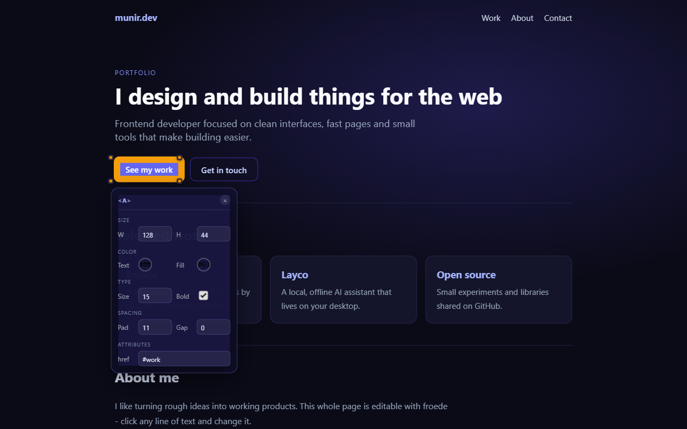
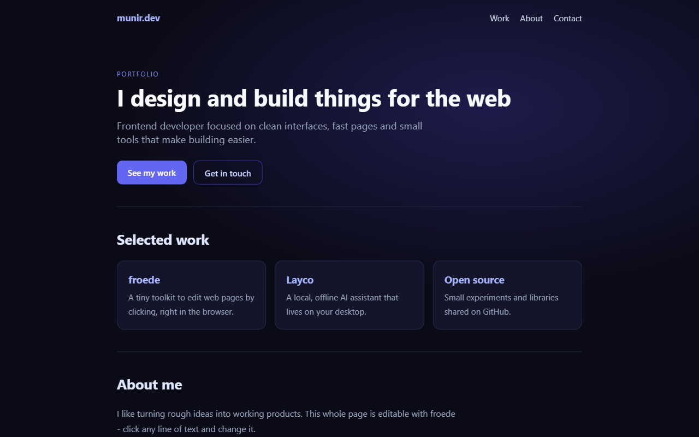
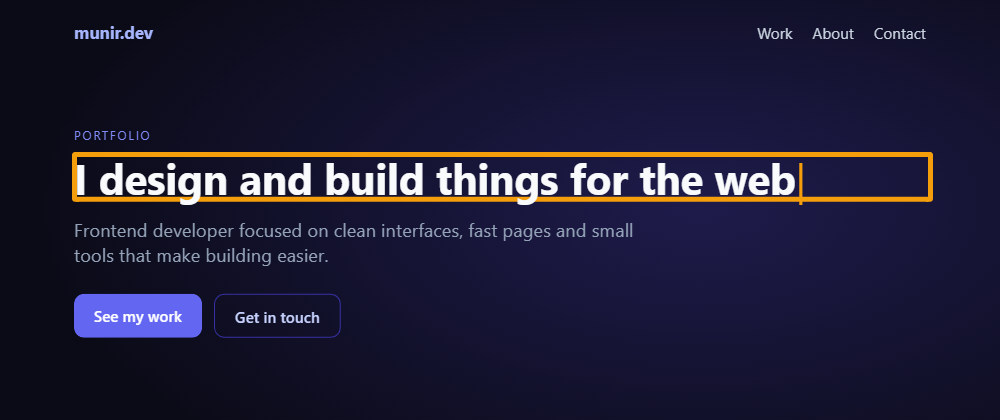
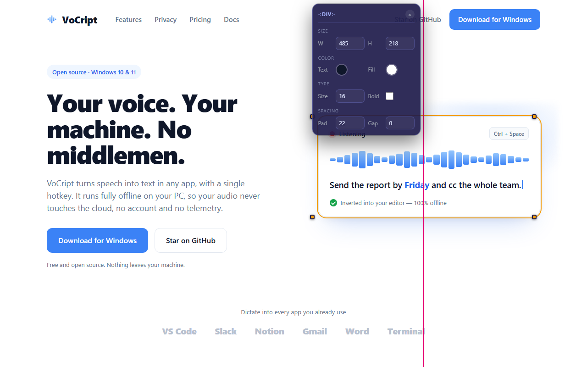

<div align="center">

<picture><source media="(prefers-color-scheme: dark)" srcset="docs/brand/froede_logooscuro.svg"></picture>

# froede

**Front + edit + code.**

A lightweight toolkit for editing the code behind a running web page or app by clicking on what you see - no diving into the source, no full IDE required.

<a href="https://chromewebstore.google.com/detail/froede/clfpgnbnfgaabdoiadjfkhfhmnfemeba"><picture><source media="(prefers-color-scheme: dark)" srcset=".github/readme/download-chrome-dark.svg"></picture></a>

[Licence MIT](LICENSE) · [latest version](https://chromewebstore.google.com/detail/froede/clfpgnbnfgaabdoiadjfkhfhmnfemeba) · Chrome/Edge · no account · no cloud, no telemetry, no AI

[npm](https://www.npmjs.com/package/froede) · [Latest release](https://github.com/Mun1to/froede/releases/latest) · [Security](SECURITY.md) · [Privacy Policy](PRIVACY.md) · [Install guide (Spanish)](docs/INSTALAR.md) · [Research notes (Spanish)](docs/INVESTIGACION.md) · [Español](README.es.md)

</div>

<p align="center"></p>

## How it works

<p align="center"><picture>
<source media="(prefers-color-scheme: dark) and (max-width: 600px)" srcset=".github/readme/how-it-works-dark-narrow.svg">
<source media="(max-width: 600px)" srcset=".github/readme/how-it-works-light-narrow.svg">
<source media="(prefers-color-scheme: dark)" srcset=".github/readme/how-it-works-dark.svg">

</picture></p>

**Status: live on the Chrome Web Store and npm**. Text, size, color, typography, spacing and attributes (alt, href, placeholder, src, title) all edit end to end on both targets (static HTML and React + Vite), verified against real files. You can also **drag elements to move them** (snapping to nearby elements, Figma-style), **delete them** with Backspace, and **undo any of it with Ctrl+Z**. Full layout tools and animations are still on the roadmap.

## How it works

```
Browser (Chrome/Edge)                     Your machine
┌────────────────────────┐               ┌─────────────────────────────┐
│ froede extension (MV3) │  WebSocket    │ froede companion (Node.js)  │
│ select/edit an element │ ────────────► │ finds the exact spot in the │
│ text, size, color, ... │  127.0.0.1    │ real source file and splices│
└────────────────────────┘  + token      │ the edit (format preserved) │
                                         └─────────────────────────────┘
                                     static HTML: parse5 splice
                                     React/Vite:  babel loc + Vite HMR
```

|  |  |
|---|---|
| **Static HTML** | the extension sends the element's DOM path; the companion maps it onto the file with parse5 (same WHATWG algorithm as the browser) and splices the text node or the `style="..."` attribute. |
| **React + Vite** | a tiny Vite plugin (`vite-plugin-froede`, dev-only) stamps every host element with `data-froede-loc="src/App.tsx:4:6"`; the companion re-parses that file and splices the exact JSX text or patches the `style={{}}` object. Vite HMR shows the change instantly. |
| **Style edits are always inline and always scoped to the exact element** | never a shared class rule, so resizing one card never moves its siblings. |
| **Security** | loopback only, Origin locked to froede's own extension ID (web pages and other extensions can never connect), shared token (constant-time compared), and the companion physically cannot write outside the project folder it was started in. Every edit verifies the current value first and aborts on mismatch. |

## Screenshots

<table>
<tr>
<td width="50%" valign="top"><br>Before</td>
<td width="50%" valign="top"><br>Editing text</td>
</tr>
</table>

<table>
<tr>
<td width="50%" valign="top"><br>Moving: center guides</td>
<td width="50%"></td>
</tr>
</table>

## Landscape (as of mid-2026)

Before starting, we looked for anything that already does this:

| Project | Open source | Simple / lightweight | Writes back to real source |
|---|---|---|---|
| [Onlook](https://github.com/onlook-dev/onlook) | Yes (Apache-2.0) | No - full editor app, sandboxed web container, Next.js + Tailwind only | Yes |
| [Stagewise](https://github.com/stagewise-io/stagewise) | Yes | Yes - browser toolbar | Indirect - routes through a connected AI coding agent |
| [VisBug](https://github.com/GoogleChromeLabs/ProjectVisBug) | Yes (Apache-2.0) | Yes - browser extension | No - ephemeral, DOM-only |
| [GrapesJS](https://github.com/GrapesJS/grapesjs) | Yes (BSD-3-Clause) | No - an SDK for building editors, not an end-user tool | No - export-based |
| [Plasmic](https://github.com/plasmicapp/plasmic) | Split (MIT core / AGPL studio) | No - separate Studio app | Publish-based, not live |
| Chrome DevTools Workspaces | Built-in | Yes | Sources panel only - element/DOM edits aren't saved |

None of them combine "point-and-click simple" with "writes straight to your real source, no sandbox, no AI middleman." That's the gap froede is aiming at.

Full research notes: [`docs/INVESTIGACION.md`](docs/INVESTIGACION.md) (Spanish).

## Quickstart

1. **Get the extension** (once per browser): [install it from the Chrome Web Store](https://chromewebstore.google.com/detail/froede/clfpgnbnfgaabdoiadjfkhfhmnfemeba).

   > Prefer not to use the store, or want the unreleased build? [Download the .zip from the latest release](https://github.com/Mun1to/froede/releases/latest), unzip it, then go to `chrome://extensions`, turn on Developer mode, click "Load unpacked" and pick the unzipped folder.

2. **Wire up your project** (static HTML projects skip this - just serve the folder on localhost):

   ```bash
   cd your-project
   npx froede init   # detects your Vite config, installs the plugin, wires it up
   ```

3. **Start the companion and pair it:**

   ```bash
   npx froede        # prints a port and a pairing token
   ```

   Open your localhost page, paste the port + token into the extension popup, hit "Save and test", then "Edit". Click to select, double-click to edit text - every change is saved to the real file, and Ctrl+Z undoes it without leaving the page.

   > Loaded unpacked? Chrome gives the extension a per-folder ID that the companion has to trust. Copy the ID shown under the extension in `chrome://extensions` and start the companion with it: `FROEDE_EXTENSION_ID=<that-id> npx froede` (PowerShell: `$env:FROEDE_EXTENSION_ID="<that-id>"; npx froede`). Once froede is installed from the Chrome Web Store this isn't needed - its ID is trusted by default.

Full walkthrough, including a ready-to-paste prompt for your AI coding session: [`docs/INSTALAR.md`](docs/INSTALAR.md) (Spanish).

## The idea

Point at an element on a live page or app, change it - text, size, color, typography, spacing, attributes, its position (drag to move) - or delete it, and have that change land in the real source code. Not in a sandbox. Not through an AI agent as a middleman. Not a throwaway DOM tweak that disappears on reload. As simple and intuitive as a devtools extension, not a full design app.

## See it in action

Click any element to select it - resize handles appear on its corners (Shift+drag to lock to one axis) and a panel shows size, color, typography, spacing and the element's editable attributes. Drag it to move it - smart guides snap it to the edges and centers of the elements around it - and press Backspace to delete it. Double-click a text element to edit its content in place. Every change writes straight to the real source file, and Ctrl+Z takes it back.

## Is it safe?

froede edits files on your computer, so this matters: everything runs **locally** (no cloud, no account, no telemetry, no AI), the part that writes files can only touch the one folder you point it at, and every piece is explained in normal words in [SECURITY.md](SECURITY.md) - including what froede can *never* do. Your undo is Ctrl+Z, and `git diff` behind it. The extension's [Privacy Policy](PRIVACY.md) covers exactly what data it does (and does not) touch.

v0.5 edits plain visible text, inline size/color/typography/spacing, and a safe allowlist of attributes (href/src reject script-scheme URLs), and adds layout basics - drag to move (with smart alignment against nearby elements), resize and delete, all with real undo/redo (Ctrl+Z). Editing one instance of a `.map()`-rendered element now warns and lets you isolate the change instead of silently rewriting every instance. Duplicating elements and animations are still on the roadmap.

## With Claude Code (or any AI assistant)

froede ships a [Claude Code](https://claude.com/claude-code) skill that spins it up for you: it detects static HTML vs React/Vite, starts the companion, and walks you through pairing and editing. Copy [`.claude/skills/froede/`](.claude/skills/froede/SKILL.md) into your own `~/.claude/skills/`, then just say *"start froede here"* in any project.

No skill? Paste this into your AI session:

> Set up froede (github.com/Mun1to/froede) to edit my localhost page by clicking. Detect static HTML vs React/Vite (run `npx froede init` once if Vite), start the companion with `npx froede`, give me the port and token for the extension popup, and guide me to edit: click to select, double-click for text, drag to move, Backspace to delete; undo with `git diff`.

## Don't trust it, check it

Published code only helps if somebody actually reads it, and almost nobody does. So
instead of asking you to trust this project, here is the prompt to check it: point your own
AI agent at this repository and get a security report, in your language, in a few minutes,
even if you do not know how to program.

**[Open AI-AUDIT.md](AI-AUDIT.md)** and paste it into Claude Code, Codex, Cursor, Copilot or
whatever you use. It is the same prompt in every public repository here, so you can compare.

> **ES:** No hace falta que te fíes. Abre [AI-AUDIT.md](AI-AUDIT.md), pega ese texto en tu IA
> y te dirá en tu idioma qué hace este programa de verdad: qué envía por internet, qué toca
> en tu ordenador y qué ejecuta al instalarse.

## License

MIT - see [LICENSE](LICENSE).

<br>

<p align="center">Made by <a href="https://munito.dev"><b>Munir Torres</b></a>. Also by him: <a href="https://adeorq.com">Adeorq</a> · <a href="https://vocript.app">VoCript</a> · <a href="https://winshotx.com">winshotx</a> · <a href="https://github.com/Mun1to/Expoal">Expoal</a> · <a href="https://github.com/Mun1to/hotkeyconfig">hotkeyconfig</a></p>
